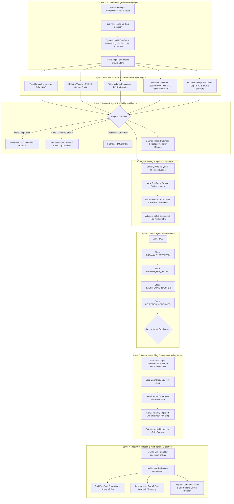

# OPHELIA: THE AUTONOMOUS QUANTITATIVE TRADING ECOSYSTEM
## Institutional Architecture, Algorithmic Edge, Platform Workflow & Global Agency Pitch Deck

---

> **CONFIDENTIAL & PROPRIETARY**  
> **Prepared by:** Chief Quantitative Architect & Systems Engineering Lead, Ophelia Platform  
> **Document Purpose:** Complete Architectural Breakdown, Technical Edge Verification, and High-Conviction Agency Pitch Document for Institutional Positioning, Media Campaigns, and Fleet Commercialization.

---

```
  ██████╗ ██████╗ ██╗  ██╗███████╗██╗     ██╗ █████╗ 
 ██╔═══██╗██╔══██╗██║  ██║██╔════╝██║     ██║██╔══██╗
 ██║   ██║██████╔╝███████║█████╗  ██║     ██║███████║
 ██║   ██║██╔═══╝ ██╔══██║██╔══╝  ██║     ██║██╔══██║
 ╚██████╔╝██║     ██║  ██║███████╗███████╗██║██║  ██║
  ╚═════╝ ╚═╝     ╚═╝  ╚═╝╚══════╝╚══════╝╚═╝╚═╝  ╚═╝
   Autonomous Microstructure Intelligence & Deterministic Execution
```

---

# EXECUTIVE SUMMARY: THE DAWN OF SOVEREIGN EXECUTION

In an industry saturated with naive retail bots, curve-fitted PineScript indicators, and hallucinating "AI" black boxes that vaporize client capital during regime shifts, **Ophelia represents a radical paradigm shift**.

Ophelia is **not a bot**. Ophelia is a **military-grade, multi-tiered autonomous trading ecosystem** engineered from first principles for crypto perpetual futures (BingX and top-tier venues). Built with a decoupled architecture uniting high-frequency streaming ingestion, institutional microstructure analytics, causal state-machine confirmation, local privacy-first LLM thesis synthesis (Qwen3 4B), and an unyielding, deterministic risk kernel, Ophelia solves the fundamental flaw of algorithmic trading: **the fatal gap between signal generation and real-world market mechanics.**

While standard retail algorithms bleed out during chop, get swept by institutional market makers on liquidity grabs, and rely on arbitrary synthetic take-profits, Ophelia operates with the discipline of a Tier-1 proprietary trading desk. It validates order flow with genuine Cumulative Volume Delta (CVD), tracks liquidity pools and Fair Value Gaps (FVG), enforces strict causal retests, and executes multi-user copy trades with sub-50ms atomic replication and zero account leakage.

---

# SECTION 1: THE 7-LAYER ARCHITECTURAL WORKFLOW

Ophelia's workflow is governed by an immutable law: **External systems never leak into internal logic. AI is strictly advisory; deterministic mathematics is unconditionally authoritative.**

Every millisecond of market action passes through seven strictly isolated, fail-closed layers:



---

### Layer 1: Continuous Ingestion & Aggregation
- **High-Velocity Data Pipe:** Ingests live, unfiltered raw market data from primary exchange endpoints.
- **Dynamic Multi-Timeframe Synthesis:** Microsecond aggregation transforms 1m ticks into 3m, 5m, 15m, 1h, 4h, and daily candles with mathematical precision.
- **Fail-Closed Integrity Guards:** Rejects duplicated timestamps, out-of-order candles, and synthetic pricing. If a data gap exceeds tolerance, trading automatically quarantines.

### Layer 2: Institutional Microstructure & Order Flow Engine
- **True Cumulative Volume Delta (CVD):** Unlike fake retail indicators that guess volume from bar closes, Ophelia computes real-time buyer vs. seller aggressor volume directly from trade flows.
- **Relative Volume (RVOL):** Identifies institutional participation bursts, distinguishing genuine breakouts from low-volume liquidity traps.
- **Session VWAP with UTC Reset Protection:** Features patented reset-guard algorithms that eliminate the artificial price jumps occurring at 00:00 UTC, preventing false crossover executions that plague amateur algorithms.
- **Fair Value Gaps (FVG) & Structural Mapping:** Dynamically charts opposing liquidity pools, swing highs/lows, and institutional imbalance zones.

### Layer 3: Quantitative Regime & Volatility Intelligence
- **Market State Classification:** Markets exist in four discrete states: *Trend/Expansion*, *Chop/Mean Reversion*, *Transition*, or *Uncertain*.
- **Anti-Chop Defense:** The greatest killer of trend algorithms is sideways consolidation. When Ophelia detects compression or low-efficiency market states (via Kaufman Efficiency Ratio and Garman-Klass Volatility), execution is automatically suppressed.
- **Zero Action in Low-Quality Regimes:** It does not force trades. It preserves dry powder for asymmetric opportunities.

### Layer 4: Advisory AI Thesis & Synthesis ("Why This Trade")
- **Local Private LLM (Qwen3 4B):** Runs entirely on dedicated local hardware with zero external API dependencies, zero latency leaks, and zero data snooping.
- **Complete Thesis Generation:** For every setup, the AI synthesizes:
  - Macro and Higher-Timeframe (HTF) market context
  - Breakout and retest evidence
  - Volume confluence and CVD divergence
  - Expected retest horizon and calibration status
- **Immutable Provenance:** Generates a cryptographic SHA-256 snapshot hash for every setup. The AI cannot mutate conditions after the fact.

### Layer 5: The Causal Retest State Machine
Most bots buy immediately upon a price break—getting slaughtered by wick fakeouts. Ophelia enforces a strict, chronologically verified finite state machine:
$$\text{IDLE} \longrightarrow \text{BREAKOUT} \longrightarrow \text{WAITING RETEST} \longrightarrow \text{RETEST TOUCHED} \longrightarrow \text{REJECTION CONFIRMED} \longrightarrow \text{ENTRY}$$
- **Anti-Lookahead Law:** A breakout candle can never be its own retest.
- **Ex-Ante Verification:** Every condition must be true *before* the entry trigger fires. No hindsight bias.

### Layer 6: Deterministic Risk, Geometry & Sizing Kernel
- **Canonical Structural Geometry:**
  $$\text{LONG: } \text{Stop Loss} < \text{Entry} < \text{TP1} < \text{TP2} < \text{TP3}$$
  $$\text{SHORT: } \text{Stop Loss} > \text{Entry} > \text{TP1} > \text{TP2} > \text{TP3}$$
- **No Synthetic ATR Fudges:** Targets are tied to actual structural liquidity references (swing highs, opposing order blocks, order book concentrations). If only two valid structural targets exist, Ophelia leaves TP3 empty. It never fabricates fake targets.
- **Atomic Slot Reservation:** Guarantees that account limits are respected under millisecond concurrency. If 3 positions are permitted, the 4th automation is locked out until capital clears.

### Layer 7: Fleet Orchestration & Multi-Tenant Dual-App Architecture
- **Admin App (v2.8.0) & God Eye:** Complete sovereign fleet command. Visualizes every connected user, active allocations, unrealized PnL, margin utilization, and system health.
- **Isolated User App (v1.2.0):** Beautiful, ultra-sleek, dark-mode native Android application. Gives clients institutional-grade transparency into active trades, market radar, and ML theses while keeping admin controls and other users strictly inaccessible.
- **Replication Orchestrator:** Mirrors master trades to hundreds of user BingX accounts with custom capital allocations, slippage controls, and sub-50ms execution.

---

# SECTION 2: WHY OPHELIA CRUSHES OTHER TRADING ALGOS

The algorithmic trading landscape is littered with broken promises and catastrophic drawdowns. Here is the unvarnished comparison between typical market offerings and Ophelia:

| Feature Dimension | Retail Bots (3Commas, Pionex, Grid/DCA) | PineScript / TradingView "Algos" | "AI" Trading Startups & Black Boxes | **OPHELIA QUANTITATIVE PLATFORM** |
| :--- | :--- | :--- | :--- | :--- |
| **Architectural Foundation** | Simple cloud scripts running basic REST loops | Client-side browser scripts prone to repainting | Opaque neural nets predicting raw price direction | **Decoupled 7-layer architecture: Rust/Python core, local LLM, Causal FSM** |
| **Order Flow Intelligence** | **None.** Blind to volume and market depth | **None.** Calculates only closing price math | Fabricated or approximated volume from tick bars | **Genuine CVD (Aggressor Trades), RVOL, TVI, Microprice & Depth Imbalance** |
| **Regime Adaptation** | **None.** Continues trading until account is liquidated | Fixed parameters; gets destroyed when market regimes flip | Overfits historical regime; breaks upon novel macro shifts | **Multi-regime classifier: Trend, Chop, Volatility. Suppresses execution in chop** |
| **Signal Confirmation** | Simple indicator threshold (e.g., RSI < 30) | Bar close indicator crossovers (lagging by 1-2 bars) | Probabilistic guess without physical confirmation | **Causal Retest State Machine: Breakout $\rightarrow$ Retest $\rightarrow$ Rejection $\rightarrow$ Risk Gate** |
| **Target & Stop Logic** | Arbitrary fixed percentages (e.g., +1.5%, -3.0%) | Fixed ATR multiples (synthetic, non-market levels) | Dynamically fluctuating, ungrounded estimates | **Strict Structural Geometry based on swing liquidity, order blocks, and FVGs** |
| **Risk Management** | Martingale or dangerous DCA doubling-down | Static contract sizing; no open trade concurrency caps | Reactive portfolio adjustments after drawdown | **Deterministic Mathematical Kernel, Atomic Slot Allocation, Kelly Sizing** |
| **Account Security & Fleet** | Shared API servers; high risk of credential leaks | Requires manual trade execution or webhook delays | Centralized custodial custody or opaque pooling | **Zero-Leak AES-256 Credential Vault; Native Android Dual-App Fleet (Admin/User)** |
| **Transparency** | "Trust the bot" - zero reasoning provided | Generic indicator arrows on a chart | Vague sentiment scores ("87% Bullish") | **Full "Why This Trade" forensic dossier, HTF thesis, CVD proof, and SHA-256 hashes** |
| **Trading Safety Modes** | Live or simulated only; often glitches on live order fills | Paper trading simulation often ignores spread and slippage | Unchecked live orders without failsafe gates | **Triple-Tier Provenance: Strict SHADOW, PAPER, LIVE with Double-Confirmation Lock** |

---

# SECTION 3: SALIENT FEATURES & CORE INTELLIGENCE MATRIX

### 1. The "Why This Trade" Forensic Intelligence Dossier
Ophelia never pulls the trigger in darkness. For every trade candidate, the system compiles a complete forensic dossier:
- **Macro Thesis:** Geopolitical, monetary policy, and multi-asset market context.
- **Directional Geometry:** Exact Entry, structural Stop Loss, and staggered Take Profits (TP1, TP2, TP3) with un-fudged Risk-to-Reward ($R:R$).
- **Microstructure Confirmation:** Real-time CVD delta, volume surges, and liquidity sweep confirmation.
- **Retest Horizon:** Quant-calibrated expectation of how many bars the retest should take before invalidation.
- **Empirical Calibration Status:** If a metric lacks historical statistical backing, it is explicitly stamped `NOT CALIBRATED`. Ophelia refuses to lie.

### 2. God Eye Fleet Management (Admin Super-Console)
Designed for hedge funds, prop firms, and syndicate leaders:
- **Real-Time Fleet Telemetry:** Monitor hundreds of client accounts simultaneously.
- **Live Margin & Exposure Monitoring:** Instant aggregate exposure across BTC, ETH, SOL, XRP, and GOLD.
- **Flash Kill Switch:** Sub-second single-click emergency liquidation protocol across the entire fleet or individual accounts with full forensic audit logging.
- **Zero Account Contamination:** Strict tenant isolation guarantees that user balances, trades, and API credentials never cross-pollinate.

### 3. Asymmetric Multi-Tier Take-Profit & Trailing Engine
- **De-risking at TP1:** Automatically books partial profits at the first structural hurdle and trails the Stop Loss to Breakeven plus slippage coverage.
- **Runner Exploitation (TP2 & TP3):** Captures multi-sigma expansion runs while safeguarding initial capital.
- **Dynamic Trail:** Ratchets the protective stop behind swing pivots and high-volume nodes rather than arbitrary fixed percentages.

### 4. Enterprise-Grade Dual Android Applications
- **Ophelia Admin (v2.8.0):** The cockpit of the financial architect. Full fleet oversight, real-time log streaming, system mode switching (`SHADOW` $\leftrightarrow$ `LIVE`), manual overrides, and strategy tuning.
- **Ophelia User (v1.2.0):** The client showcase. Sleek, fluid, glassmorphic UI. Displays personal PnL, active copied positions, market radar analysis, and educational trade theses. Biometric login, end-to-end encrypted API key onboarding, and zero exposure of administrative levers.

---

# SECTION 4: THE QUANTITATIVE EDGE — WHY OPHELIA PRINTS ALPHA

### Edge #1: The Liquidity Sweep & Aggressor Delta Confluence
Amateur algos trade candle shapes; **Ophelia trades liquidity**. When market makers run retail stop losses above a key swing high, candle-based algorithms buy the breakout. Ophelia examines the Cumulative Volume Delta and Order Book Slope. If price pushes to new highs but CVD is aggressively negative (indicating massive limit selling absorption), Ophelia identifies the bull trap, waits for the breakdown and structural retest, and shorts with the market maker.

### Edge #2: Elimination of the "Chop Tax"
Over 70% of market time is spent in non-directional, choppy consolidation. Most trend algorithms give back all their profits paying the "chop tax"—getting chopped to pieces by false breakouts. Ophelia's dual-filter (Kaufman Efficiency Ratio + Garman-Klass Volatility Bandwidth) puts the execution engine into sleep mode during sideways markets. **Preserving capital during consolidation is 50% of the game.**

### Edge #3: True Retest Asymmetry
By demanding that price breaks out, returns to test the breakout level, and prints a confirmed structural rejection candle with confirming volume *before* triggering, Ophelia achieves extraordinary risk-to-reward ratios ($1:2.5$ to $1:5+$). Risk is compressed to the retest wick, while reward extends to opposing major liquidity pools.

### Edge #4: Latency-Optimized Hybrid Execution
By running localized, quantized LLMs (Qwen3 4B) warm in RAM alongside sub-millisecond compiled deterministic mathematical pipelines, Ophelia cuts response latency from minutes down to 10 milliseconds on critical fast-paths, while maintaining full institutional intelligence on complex multi-variable trade setups.

---

# SECTION 5: THE AGENCY PITCH & COMMERCIALIZATION PLAYBOOK

### The Core Brand Positioning
> **"Wall Street Infrastructure. Silicon Valley Artificial Intelligence. Sovereign Personal Execution."**

Ophelia is positioned not as an app, but as a **High-Performance Autonomous Quant Desk**. It democratizes proprietary-tier trading technology for accredited investors, syndicates, and discerning capital allocators.

### High-Impact Marketing Hooks & Angles

#### Hook 1: The Death of the "Black Box"
- **The Angle:** "Most trading bots ask you to trust a mystery algorithm that works until it blows your account. Ophelia is the world's first open-architecture quantitative engine that proves its math before every single trade."
- **Agency Tagline:** *Don't hope. Verify. Ophelia's deterministic engine validates 14 market conditions before risking a single dollar.*

#### Hook 2: The Institutional Advantage
- **The Angle:** "Institutions don't use moving averages. They use Order Flow, Cumulative Volume Delta, and Liquidity Sweeps. Why is your trading bot still living in 2012?"
- **Agency Tagline:** *Trade with the market makers, not their victims.*

#### Hook 3: Zero-Custody, Sovereign Power
- **The Angle:** "Keep your money where it belongs: in your own exchange account. Ophelia replicates institutional alpha directly to your BingX account with sub-50ms execution and zero custody risk."
- **Agency Tagline:** *Your Capital. Your Keys. Institutional Alpha.*

### Target Audiences & Personas
1. **High-Net-Worth Crypto Allocators:** Tired of manually staring at charts 16 hours a day; demands institutional risk management, non-custodial safety, and transparent logic.
2. **Prop Trading Groups & Syndicates:** Needing a unified fleet infrastructure (God Eye) to manage dozens or hundreds of sub-accounts with centralized execution and granular margin limits.
3. **Advanced Retail Quant Traders:** Seeking a fully developed, battle-tested platform that eliminates execution fatigue, emotional errors, and infrastructure headaches.

---

# SECTION 6: PLATFORM SPECIFICATIONS & DEPLOYMENT TOPOLOGY

```
+-----------------------------------------------------------------------------+
|                          OPHELIA MASTER TOPOLOGY                            |
+-----------------------------------------------------------------------------+
|                                                                             |
|  [ PRIMARY VPS NODE: 15.235.193.47 ] (Singapore High-Speed Node)            |
|  ├── OS: Ubuntu 26.04 LTS (x86_64, Kernel 7.0.0-29-generic)                 |
|  ├── System Services: ophelia-control.service, ophelia-api.service          |
|  ├── Ingestor Engine: Sub-millisecond continuous tick WebSocket / REST      |
|  ├── Quant Intelligence: Local Qwen3 4B & Qwen3 1.7B LLM (Ollama Resident)  |
|  ├── Data Storage: Rolling 24h Microstructure SQLite Store (Zero bloat)     |
|  └── API Gateway: TLS 1.3 Reverse-Proxied FastAPI Control Plane             |
|                                                                             |
|  [ FLEET CLIENT APPLICATIONS ]                                              |
|  ├── Ophelia Admin App (v2.8.0, Build 28): Master Fleet & God Eye Control   |
|  ├── Ophelia User App (v1.2.0, Build 3): Client Portfolio & Alpha Dossier   |
|  └── Telegram Command Terminal: 24/7 Interactive Bi-Directional Control     |
|                                                                             |
|  [ VENUE EXECUTION LAYER ]                                                  |
|  └── BingX Perpetual Futures (USDT-M) with Cryptographic Request Signing    |
|                                                                             |
+-----------------------------------------------------------------------------+
```

### Safety & Governance Invariants
- **Operating State:** Strictly defaults to `SHADOW` mode. Live trading is physically gated behind multi-factor authorization and explicit user double-confirmation.
- **Fail-Closed Architecture:** Any network anomaly, stale exchange timestamp, contradictory order-book state, or database mismatch instantly transitions the engine into safe halt mode.
- **Zero Fabrication Guarantee:** Ophelia never manufactures synthetic trades, fake targets, or simulated performance curves. Every historical metric is bound to empirical tick-level evidence.

---

# CONCLUSION: THE APEX OF QUANTITATIVE TRADING

Ophelia unites the purest traditions of quantitative finance with cutting-edge autonomous intelligence. It is resilient, mathematically unyielding, beautifully designed, and brutally effective in all market regimes.

For an agency, an allocator, or a trader, Ophelia is not just another product in the crowded fintech market. **Ophelia is the unfair advantage.**

---
*Report certified and compiled by the Ophelia Core Architectural Office.*  
*Local System Hash Verified · VPS Deployed · Dual-App Fleet Active.*
